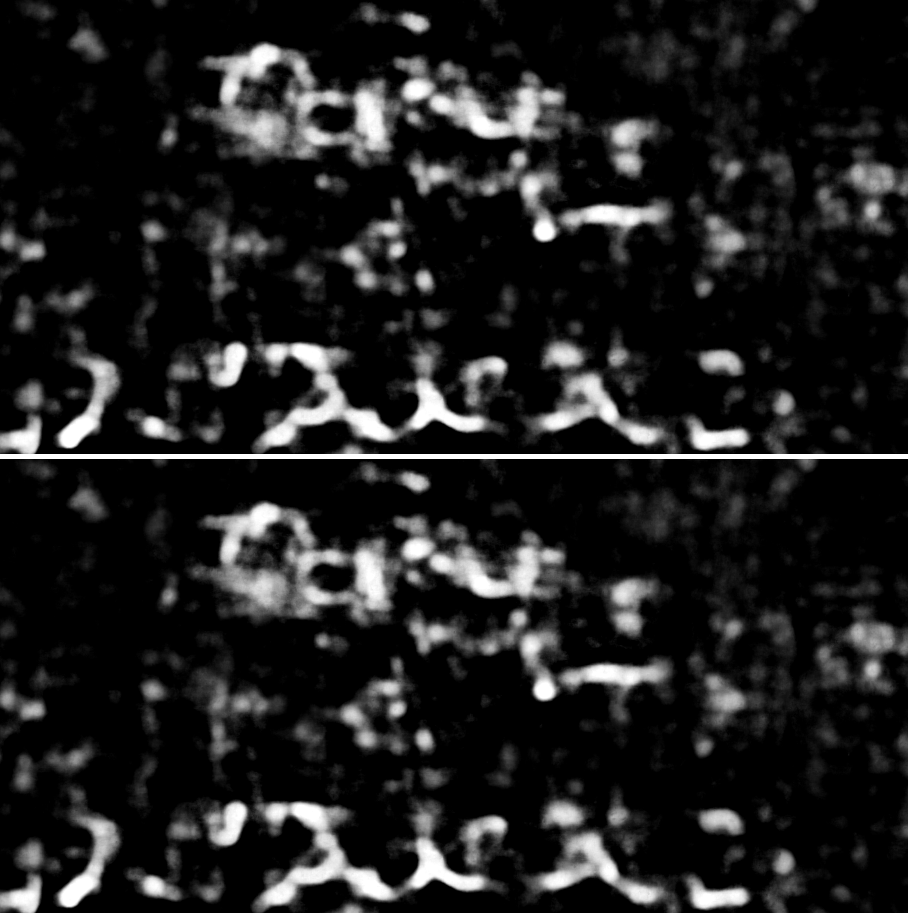

# Read a Herculaneum scroll segment on a laptop CPU — no GPU, no compiler

> **DRAFT for Jamie's review — not published.** Tested with villa @ c8f3ba4 (Nov 20, 2026). Numbers are from one Linux box (8 vCPU Xeon with AMX, 16 GB RAM, no GPU,
> shared with other jobs). Tested on Linux and Windows (AMD Ryzen 5 7520U laptop, no GPU, no compiler: the 2048×4096 example ran in 681 s); macOS not yet tested.

One command turns a published Vesuvius Challenge surface volume into an ink image with **Reader V3**, the 9 µm ink model
now used in most First Letters submissions. It streams just the chunks it needs from the public open-data bucket, runs on
the CPU in ≤ 2 GB of RAM, and produces the same ink map as a GPU run of the same model (98.4 % of pixels identical,
all within 1/255).



*PHerc1447 segment w058 (8.64 µm), a 2048 × 4096 px area (≈18 × 35 mm). Top: this script on CPU. Bottom: the Reader V3
prediction published in the open-data bucket for the same segment. Display: median → 99.5th percentile stretch.*

## Quick start (any OS with Python 3.10+; nothing to compile)

```bash
# 1. Environment with CPU-only PyTorch (≈1 GB; no CUDA wheels)
python -m venv .venv && source .venv/bin/activate          # Windows: .venv\Scripts\activate
pip install torch torchvision --index-url https://download.pytorch.org/whl/cpu
pip install -r requirements-cpu.txt
pip install ./vcr_lite                                      # pure-Python stand-in for villa's vc_reader (see below)

# 2. villa's ink-inference code, without the rest of the monorepo (≈30 MB, a few seconds)
git clone --depth 1 --filter=blob:none --sparse https://github.com/ScrollPrize/villa.git
git -C villa sparse-checkout set vesuvius/src/vesuvius

# 3. Read a segment (downloads the Reader V3 checkpoint once and checks its sha256)
python read_segment_cpu.py \
  s3://vesuvius-challenge-open-data/PHerc1447/segments/20260928183143-w058/surface-volumes/8.64um-1.2m-116keV-volume-20250521151220.zarr \
  --roi 1500 3548 800 4896 --out out/w058 --villa villa
# -> out/w058.tif (8-bit ink score, white = ink) and out/w058.png (preview)
```
Drop `--roi` to read the whole segment. Use `--direction both` once per new segment and keep the order that shows letters.

## How fast?

Same 2048 × 4096 area of PHerc1447 w058 (299 patches of 17 × 384 × 384), streamed from S3, forward direction:

| Setting | Time | Peak RAM | Output vs team's GPU map |
|---|---|---|---|
| villa defaults on CPU (torch uses all 8 threads on a busy box) | 2,096 s | 1.3 GB | 98.4 % identical, max diff 1/255 |
| **this script, default** (threads = idle cores, batch 2) | **161 s** | 1.8 GB | same |
| `--compile` | 155 s (incl. ~30 s warm-up) | 1.9 GB | same |
| `--bf16` (experimental, AMX CPUs) | 115 s | 1.5 GB | 69 % identical, 97 % within 2/255, letters unchanged |
| Whole segment, 4580 × 8080 px, default | 487 s (8.1 min, 893 patches) | 2.0 GB | 98.6 % identical, max diff 1/255 |

**The big win is thread count.** On a CPU that is already partly busy, PyTorch's default of one thread per core made each
patch 5–8× slower (4.5 s vs 0.45–0.6 s per patch in a micro-benchmark). The script samples idle cores for half a second and
uses that many threads; pass `--threads N` to override.

Tried and not worth it on this model: `channels_last` (no gain; the 3-D stem cannot use it), dynamic int8 quantization (no
effect; the model has no Linear layers to quantize), larger batches beyond 2–4 (≈10 % at most). `--amp-dtype bf16` in villa's
CLI is ignored on CPU because villa only autocasts on CUDA; `--bf16` here patches that single call.

## What `vcr_lite` is, and when to use it

Since villa #2440, ink inference imports `vc_reader`, villa's C++ reader. On Linux you can build it (6 min with 2 jobs, ~3.6 GB
per compiler process); on Windows it currently needs the Visual Studio clang-cl toolchain and Ahggggg's open PR #2533. If you
can't or don't want to compile, `pip install ./vcr_lite` provides the few `vc_reader` functions flat ink inference uses
(Zarr reading via zarr-python, the robust/percentile normalization, TIFF writing). Its output is **byte-identical** to the
native reader in our tests (0 of 1,048,576 pixels differ; normalization max difference ≤ 1 float32 ulp). It is a stop-gap for
inference only; everything else in villa should use the real `vc_reader`.

## Known snags (and fixes)
- `timm` from PyPI may pull a CUDA `torchvision` that breaks CPU torch (`operator torchvision::nms does not exist`):
  reinstall torchvision from `https://download.pytorch.org/whl/cpu`.
- villa's full `uv sync --extra models` builds the whole C++ tree and downloads CUDA wheels; flat ink inference does not need it.
- Reader V3's README mentions `koine_machines.inference.infer`; on current villa main it is `vesuvius.ink_detection.inference.infer`.
- A local copy without pyramid levels makes the occupancy scan read the full-resolution array; keep the published pyramid or
  use `--roi`.

## Credits
- **Reader V3** by **Domenico Russo** (@klavis223) — model, checkpoint (MIT) and evaluation:
  github.com/DomRusso2/reader-v3, huggingface.co/domenicor046/reader-v3.
- **villa** by the Vesuvius Challenge team and contributors — the inference code this script calls (github.com/ScrollPrize/villa).
- **Ahggggg** — Windows reports and PRs (#2533 native vc_reader build on Windows, #2419 render hang on exit, #2420 Intel XPU)
  that showed where CPU and non-NVIDIA users get stuck. This repo complements that work rather than replacing it.
- PHerc1447 surface volume and the reference Reader V3 map: Vesuvius Challenge open data.

## Data license and citation
Vesuvius Challenge data is licensed **CC BY-NC 4.0** unless noted otherwise: non-commercial use, with attribution. If you
publish or present results, cite *Vesuvius Challenge – CT Scans of Herculaneum Papyri* (Angelotti, Parsons, Johnson, et al.,
Vesuvius Challenge); legacy Scrolls 1–4 data comes from EduceLab-Scrolls (Parsons et al., 2023, arXiv:2304.02084).
The code in this repo is MIT; outputs you make from the data inherit the data's terms.

## Status
Tested on Linux and on Windows (PowerShell 5.1, Python 3.12.9, CPU-only torch, `vcr_lite`, AMD Ryzen 5 7520U: 681 s for the quick-start example). Windows tip: if `activate` is blocked, run `Set-ExecutionPolicy -Scope CurrentUser RemoteSigned`; Python 3.12 is the tested version. macOS and more Windows testers wanted — please report: OS, CPU, Python version, the command, time, and any error.
